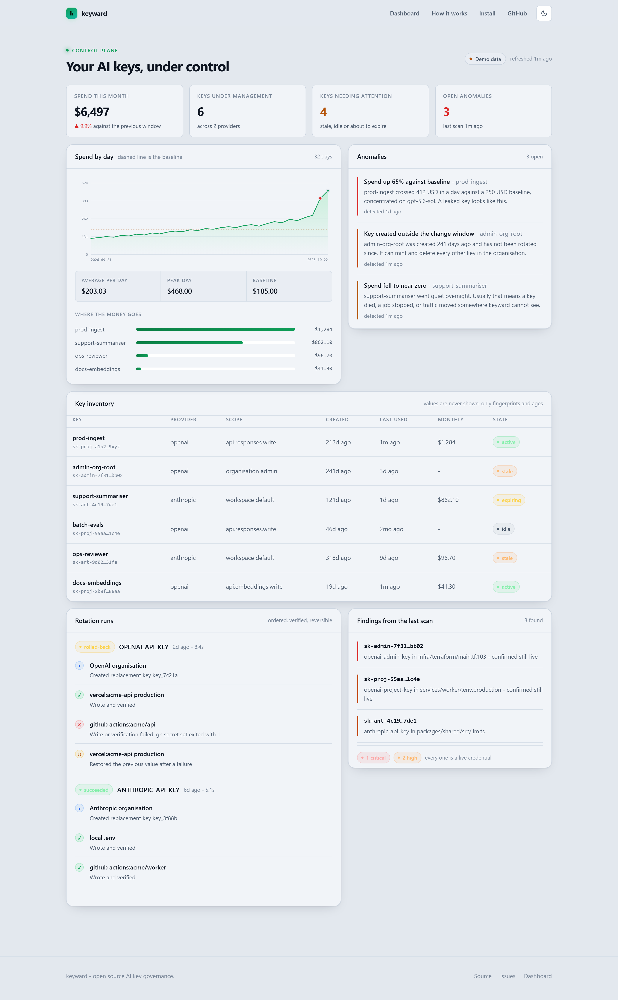
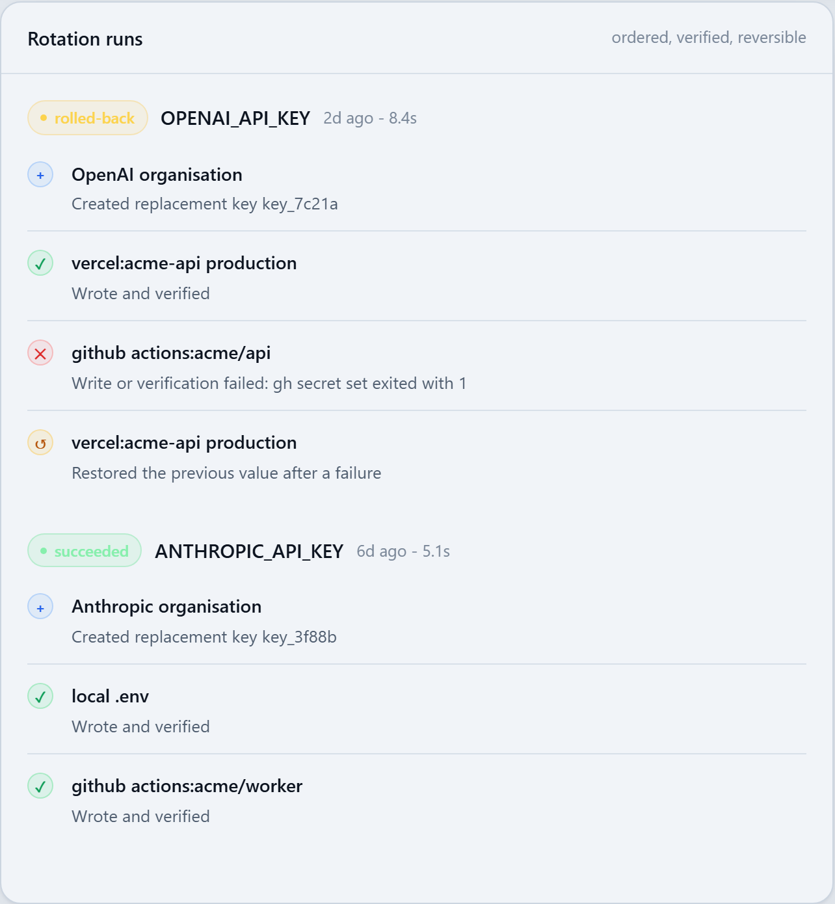
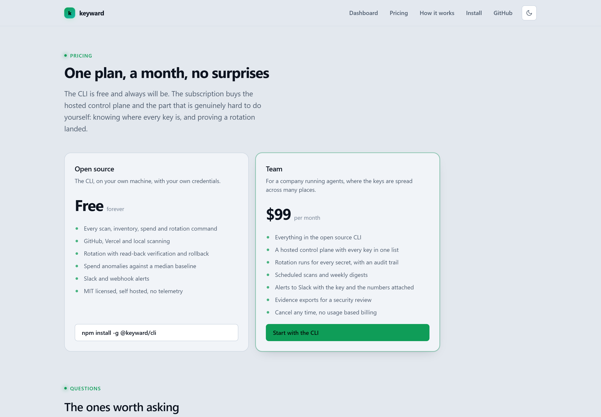
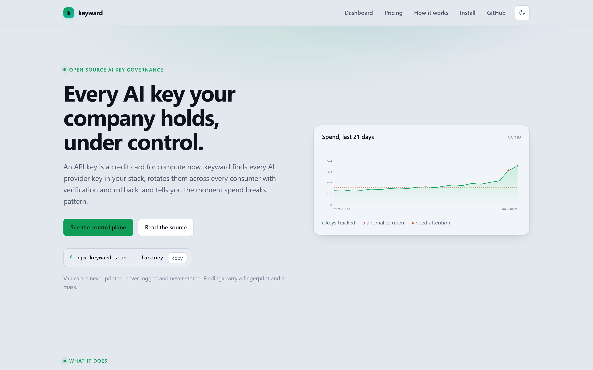
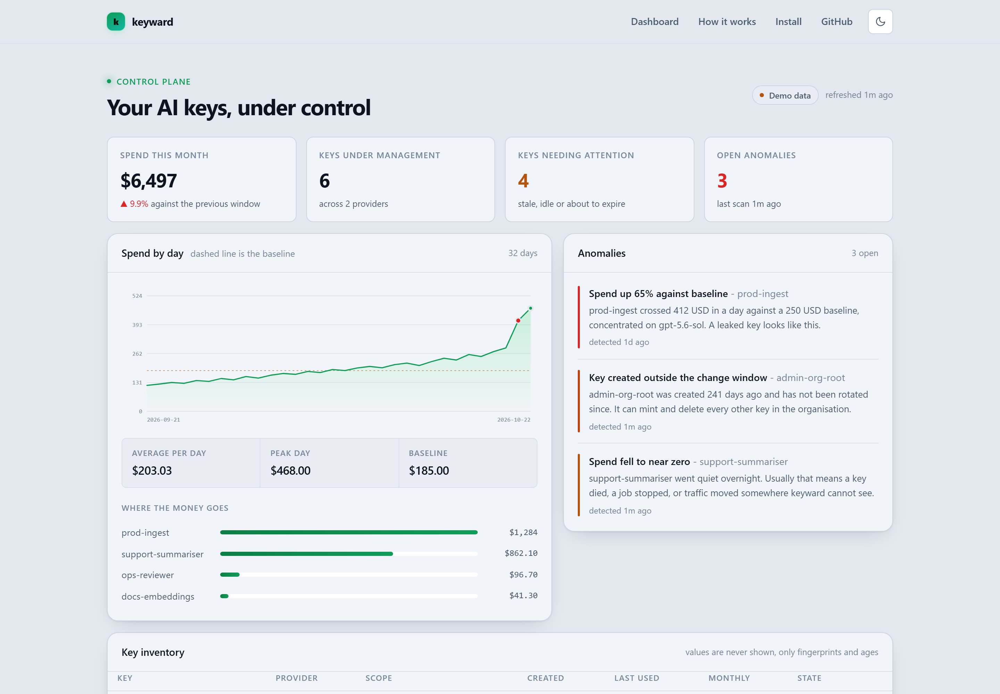

# keyward

Find, rotate and police every AI API key your company holds. An API key is a credit card for
compute now, and keyward is the part of AI key management nobody has solved: rotating a secret
across every consumer that holds it, without an outage, with proof it landed.

[](https://keyward-seven.vercel.app)
[](https://github.com/devtechedge/keyward/actions/workflows/ci.yml)
[](https://www.typescriptlang.org/)
[](https://nextjs.org/)
[](LICENSE)

---

## Live Demo

**https://keyward-seven.vercel.app**

> **Status:** the control plane is live and hosted. It currently renders a demo dataset, because the
> project is new and no organisation has connected a provider yet. The moment the CLI pushes a real
> scan or a real rotation, the same view shows that data. The interface always says which mode it is
> in, so a demo is never passed off as live.

---

## Screenshots

| Control plane | Rotation run | Pricing |
| --- | --- | --- |
|  |  |  |

| Landing | Light mode |
| --- | --- |
|  |  |

---

## The problem

Three jobs hide inside "AI key management", and most tools only do one of them.

| Job | State of the market |
| --- | --- |
| **See every key you hold** | Solved and nearly free. GitHub secret scanning blocks OpenAI and Anthropic keys by default. gitleaks and trufflehog are mature. |
| **See what the keys cost** | Saturated. Several credible tools charge under 30 USD a month for a spend dashboard. |
| **Rotate a key across everything that uses it** | **Not solved.** One logical secret lives in Vercel, GitHub Actions, Supabase, a local `.env` and CI. |

keyward is built around the third job.

## What makes rotation hard

Most rotation advice is wrong in one specific way: **it revokes too early**.

```
1. create the replacement at the provider
2. write it to every consumer, one at a time
3. read each one back and prove it changed
4. only now revoke the old secret
```

Deactivating the old key before your services have picked up the replacement is how rotation causes
an outage. Rotating weekly without a dual key window causes one every week.

Rotation also does not close the real hole. A key copied before the rotation is still valid. That is
why keyward also reports key age, idle time and scope, so you can see which credentials are worth
the trouble of rotating at all.

---

## Features

- **Finds keys you forgot.** The working tree, git history, a whole GitHub account, or every
  environment variable in a Vercel team, plus the provider's own inventory, in one list with age,
  idle time and scope.
- **Rotates without a window of downtime.** Create, write to every consumer, prove each one now
  holds the new value, then revoke. A failure rolls back.
- **Knows what is due.** `keyward due` lists the secrets that are past their rotation window or
  have gone unused long enough to be safe to revoke, with the reason for each.
- **Catches spend that looks wrong.** A median baseline rather than a mean, so one previous spike
  does not hide the next one. Spikes and collapses are both flagged.
- **Never shows a value.** Findings carry a non-reversible fingerprint and a mask. Nothing is
  printed, logged or stored.
- **Plans are values free.** A rotation plan names projects, repos, variables and paths, so it is
  safe to commit and safe to review.
- **Reads OpenAI and Anthropic directly.** Through their Admin APIs, with expiry and scopes where
  the provider supports them.
- **Pings you when spend breaks pattern.** Slack or a webhook, with the numbers attached.
- **Runs hosted.** Connect an account in the browser and the control plane shows your own keys.
  Credentials are encrypted at rest and every row is scoped to one account.

---

## Pricing

The CLI is free and MIT licensed. The hosted control plane is **$99 a month**, one plan, no usage
based billing. Full detail on the [pricing page](https://keyward-seven.vercel.app/pricing).

---

## Tech Stack

| Layer | Technology |
| --- | --- |
| CLI | Node 24, TypeScript, zero runtime dependencies beyond `zod` |
| Core | Provider adapters, detection patterns, rotation engine, anomaly detection, alerting, billing |
| Frontend | Next.js 16, React 19, server rendered, no chart library, inline SVG |
| Data | Neon Postgres, account scoped, with a demo dataset when no account is connected |
| Hosting | Vercel (Hobby), team `devtechedge1` |
| CI | GitHub Actions, Node 24, typecheck, tests, build, CLI smoke test |

---

## Quick Start

```bash
npm install -g @keyward/cli

# Find every AI provider key in the working tree and in git history
keyward scan . --history

# Or scan a whole GitHub account, or a whole Vercel team
keyward scan --github devtechedge
keyward scan --vercel devtechedge1

# Connect a provider. The admin key goes in a 0600 file, never in the config.
keyward connect --provider openai --token sk-admin-...

# List every key the organisation holds, with age, idle time and policy verdicts
keyward inventory

# Show which secrets are due for rotation, and why
keyward due

# Read spend, flag anomalies, and ping Slack when something breaks pattern
keyward spend --days 30 --alert

# Rotate across every consumer, with verification and rollback
keyward rotate plan.json --dry-run
keyward rotate plan.json
```

### A rotation plan

The plan names projects, repos, variables and paths. It never holds a secret.

```json
{
  "version": 1,
  "secrets": [
    {
      "name": "OPENAI_API_KEY",
      "provider": "openai",
      "overlapSeconds": 3600,
      "targets": [
        { "id": "vercel-prod", "kind": "vercel-env", "project": "acme-api",
          "environments": ["production"], "variable": "OPENAI_API_KEY" },
        { "id": "gha-api", "kind": "github-actions", "repo": "acme/api",
          "variable": "OPENAI_API_KEY" },
        { "id": "local", "kind": "local-env", "path": ".env.local",
          "variable": "OPENAI_API_KEY" }
      ]
    }
  ]
}
```

Target kinds: `vercel-env`, `github-actions`, `supabase-env`, `local-env`, `fly-secret`,
`netlify-env`, `cloudflare-secret` and `manual`. Anything with a command works too, and the new
value arrives on stdin so it never lands in a process listing or a shell history.

---

## Providers

| Provider | Inventory | Rotate | Spend |
| --- | --- | --- | --- |
| OpenAI | yes, Admin API | yes, service account and admin keys with expiry and scopes | yes |
| Anthropic | yes, Admin API | yes, organisation keys | yes |

Detection covers OpenAI (admin, project, service account), Anthropic (admin and standard),
OpenRouter, Google AI, Groq, Hugging Face, xAI, Supabase and DeepSeek.

---

## The hosted control plane

The CLI is the tool. The hosted app is the place to see the result and to let more than one person
look at it.

- **Connect an account** on the settings page. The credential is encrypted with a key that stays in
  the server environment, and is decrypted only for the request that needs it.
- **Every row is scoped to an account.** A visitor without an account sees the demo dataset, and
  never another account's rows.
- **The mode is always stated.** The dashboard says `Live data` or `Demo data`, so a demo is never
  passed off as live.

Setup for a self hosted deployment: create the tables with `POST /api/setup` (it is idempotent and
migrates an older database), and set `KEYWARD_ENCRYPTION_KEY` to 32 bytes, hex or base64.

---

## Development

```bash
npm install
npm run build
npm test
npm run dev:web
```

## Agent workflows

The workflows used to work on this repository live in [`.agents`](.agents/README.md).

## License

MIT. See [LICENSE](LICENSE).
